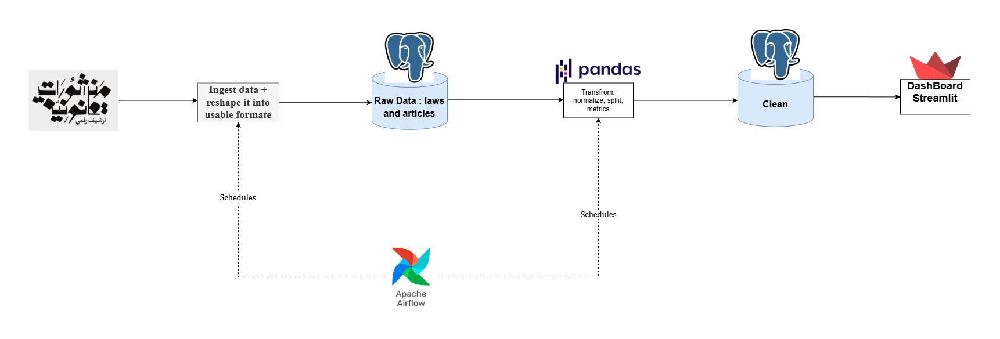

# Qanon pulse 
Qanon pulse collects the text of Egyption laws, cleans and normalizes the Arabic text, and computes simple, explainable metrics: how long articles are, how dense the sentences are, which laws change most, and which legal terms appear for the first time. Results are meant to be explored in an interactive dashboard.


## Install
 
### Requirements
 
- Docker and Docker Compose v2
- Git
- Python 3.13 and uv
### Setup
 
```bash
git clone https://github.com/Youssefay-cloud/Qanon-Pulse.git
cd Qanon-Pulse
```

## Usage
 
Start the whole local stack (database, pgAdmin, ingestion, transform):
 
```bash
docker compose up --build
```
 
What happens, in order:
 
1. `db` starts PostgreSQL and passes its healthcheck.
2. `ingestion` loads `reshaped_laws.json` into the `laws` and `articles` tables (truncate-and-reload, so it is safe to re-run).
3. `transform` waits for ingestion to finish, then normalizes every article and writes the `articles_clean` table. Raw tables are never modified.

Run the Arabic text tests:
 
```bash
cd transform
uv run pytest
```


Architecture




| Layer | Purpose | Tables / files |
|---|---|---|
| Raw | Data exactly as collected | `laws`, `articles` |
| Clean | Normalized Arabic text | `articles_clean` |
| Gold | Metrics ready for the dashboard | `TODO` |

## Data Sources
 
- **[Manshurat Qanuniya](https://manshurat.org)**: open-access Arabic legal database run by the Law and Society Research Unit at the American University in Cairo.

## Planned Metrics
 
| # | Metric | What it answers |
|---|---|---|
| 1 | Structure tracker | How many articles and chapters does each version have, and how long is the average article? |
| 2 | Legislative instability index | Which laws are amended most often and by how much text? |
| 3 | Sentence length and density | Is legal language getting denser over time? |
| 4 | New terminology log | Which legal terms appear for the first time in each amendment? |
| 5 | Cross-domain comparison | How does the language of the Constitution compare with the Labor Law and the Penal Code at the same point in time? |


## Project Status
 
| Stage | Status |
|---|---|
| Ingestion (JSON to PostgreSQL) | Done |
| Arabic normalization (`articles_clean`) | Done |
| Article splitter | Next |
| Metrics computation | Planned |
| Airflow orchestration | Planned |
| Dashboard (Streamlit) | Planned |
| Cloud deployment (Hugging Face) | Planned, last step |